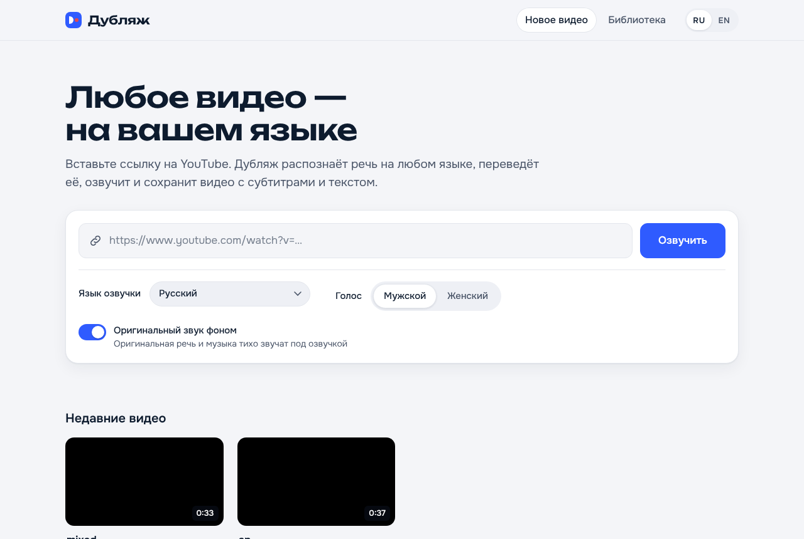

# Dubber 🎙️ — any YouTube video → a dub in your language

Paste a YouTube link (speech in **any language**, even several in one video), pick one of **12 dub languages**
(Russian by default; English, Hebrew, Ukrainian, Spanish, French, German, Italian, Portuguese, Arabic, Chinese,
Japanese) and get back:
- **the same video with a voice-over** (original audio kept quietly underneath, and as a 2nd selectable track),
- **subtitles** in the dub language (`.srt`, also embedded in the MP4),
- **a transcript**, plus a bilingual original + translation transcript for studying.

Made for people who learn from videos in other languages. Runs on your own PC, free by default.

**Инструкция на русском:** [Установка и все функции](#ru) · **מדריך בעברית:** [התקנה וכל האפשרויות](#he) ·
**Developers:** [How it works](#how-it-works)

---

<a id="ru"></a>
## 🇷🇺 «Дубляж видео» — полная инструкция

Программа озвучивает видео с YouTube, TikTok, Instagram или Facebook или видеофайл с компьютера — на русском или на одном из 12 языков. Речь в видео
может быть на любом языке, даже на нескольких сразу. Кроме видео с озвучкой вы получаете субтитры и текст перевода.
Программа работает на вашем компьютере с Windows и бесплатна (платный перевод с Claude — по желанию). Нужен интернет.

**Содержание:** [Установка](#ru-install) · [Знакомство с сайтом](#ru-site) · [Озвучить видео](#ru-dub) ·
[Пока идёт озвучка](#ru-job) · [Просмотр](#ru-watch) · [Библиотека](#ru-library) · [Перевод с Claude](#ru-claude) ·
[Вход на сайты](#ru-logins) · [Телефон](#ru-phone) · [Место на диске](#ru-disk) · [Обновления](#ru-updates) · [Полезно знать](#ru-tips) · [Если что-то не так](#ru-help)

<a id="ru-install"></a>
### 1. Установка (один раз, около 15–20 минут)

1. **Скачайте программу:** **[⬇ Скачать «Дубляж видео»](https://github.com/Adamzvulun/Dubber/archive/refs/heads/main.zip)**.
   Скачается файл `Dubber-main.zip` (обычно в папку «Загрузки»).
2. **Распакуйте его:** нажмите на `Dubber-main.zip` **правой** кнопкой мыши → **«Извлечь все…»** → выберите папку,
   например «Документы» → **«Извлечь»**. Появится папка `Dubber-main` — это и есть программа. Не удаляйте её.
3. **Запустите:** откройте папку `Dubber-main` и дважды щёлкните файл **`Start Dubber`**.
4. **Если Windows предупреждает** (так бывает с файлами из интернета):
   - синее окно «Windows защитила ваш компьютер» → **«Подробнее»** → **«Выполнить в любом случае»**;
   - «Открыть файл — предупреждение системы безопасности» → **«Запустить»**;
   - «Разрешить этому приложению вносить изменения?» → **«Да»** (устанавливаются Python, ffmpeg и библиотеки
     Microsoft Visual C++).
5. **Подождите 10–15 минут.** В чёрном окне программа сама скачивает и устанавливает всё нужное. **Не закрывайте
   окно**, пока сайт не откроется.
6. **Готово:** сайт откроется в браузере, а на рабочем столе появится значок **«Дубляж видео»** (синий квадрат с
   белой буквой D). Дальше запускайте программу только им.

<a id="ru-site"></a>
### 2. Знакомство с сайтом

- **Как открыть:** дважды щёлкните значок «Дубляж видео». Откроются **чёрное окно** и **сайт в браузере**.
  Чёрное окно — это сама программа: пока вы пользуетесь сайтом, оно должно быть открыто (его можно свернуть).
- **Разделы** (вверху страницы):
  - **«Новое видео»** — здесь озвучивают видео и видят, как идёт работа;
  - **«Библиотека»** — все готовые видео;
  - **⚙ «Настройки»** (шестерёнка) — перевод с Claude, глоссарий, голос оригинала, место на диске.
- **RU / EN** справа вверху — язык самого сайта (русский или английский).
- Тёмное оформление включается само, если в Windows выбрана тёмная тема.
- Внизу страницы написан номер версии программы, например «Дубляж 0.6.1».
- Сайт работает только на вашем компьютере (адрес `http://127.0.0.1:7860`) — в интернете его никто не видит.

<a id="ru-dub"></a>
### 3. Озвучить видео

1. **Что озвучить** — вставьте в большое поле на странице «Новое видео»:
   - **ссылку на видео YouTube**: откройте видео, скопируйте адрес из адресной строки браузера (**Ctrl+C**) и вставьте
     в поле (**Ctrl+V**);
   - **ссылку на видео TikTok, Instagram (Reels) или Facebook** — так же из адресной строки или кнопкой
     «Поделиться» → «Копировать ссылку». Видео, открытые для всех, скачиваются без входа в аккаунт. Закрытые (например,
     из закрытого аккаунта) — только после входа, см. [«Вход на сайты»](#ru-logins);
   - **несколько ссылок** — каждую с новой строки (новая строка — **Shift+Enter**). Они встанут в очередь и
     озвучатся одна за другой;
   - **ссылку на плейлист** — озвучатся все его видео. Если в плейлисте больше 10 видео, программа сначала спросит.
     Если ссылка ведёт на видео *внутри* плейлиста, программа спросит: **«Только это видео»** или **«Весь
     плейлист»**;
   - **видеофайл с компьютера** — нажмите **«выберите видеофайл на компьютере»** под полем или просто перетащите файл
     мышью на поле. Подходят MP4, MKV, WEBM, MOV, AVI и подобные. Над полем видно, как идёт загрузка файла.
2. **Язык озвучки** — русский, английский, иврит, украинский, испанский, французский, немецкий, итальянский,
   португальский, арабский, китайский или японский. Программа запоминает ваш выбор.
3. **Голос** — **«Мужской»** или **«Женский»**. Если установлен голос оригинала (см. ниже), есть и третий вариант —
   **«Оригинал»**.
4. **«Оригинальный звук фоном»** (включён сам): оригинальная речь и музыка тихо звучат под озвучкой. Выключите —
   будет слышна только озвучка.
5. **«Убрать голос диктора»** (выключен сам; работает, только когда включён «Оригинальный звук фоном»): музыка и
   звуки видео остаются, а голос оригинального диктора убирается. Это дольше — примерно +5 минут на каждые 10 минут
   видео; в первый раз программа скачает нужную модель (около 170 МБ).
6. Нажмите **«Озвучить»** (или клавишу **Enter**).

Выбор голоса и звука программа запоминает до следующего раза. Если в поле несколько ссылок и вы нажали «Отмена» в
вопросе о плейлисте, остальные ссылки всё равно озвучатся, а ссылка на плейлист останется в поле.
Если окно программы на компьютере закрыть, страница покажет «Программа на компьютере не отвечает»; запустите
«Дубляж видео» с рабочего стола — страница подключится сама.

Каждая озвучка сохраняется отдельно — даже если тот же ролик озвучен ещё раз с теми же настройками: прежние
остаются. У каждой озвучки указаны дата и точное время, когда она сделана.

**Голос оригинала** (по желанию; только для компьютеров с **видеокартой NVIDIA с памятью от 6 ГБ**, например GeForce
RTX 3060, 3070 и новее). Озвучка голосами самих говорящих: программа копирует голос каждого человека в видео и
говорит им на языке озвучки.
- Включается один раз: ⚙ «Настройки» → **«Голос оригинала»** → **«Установить»**. Программа проверит видеокарту
  (напишет «…— подходит») и скачает около 6 ГБ; это 10–30 минут, программой можно пользоваться дальше. Полоска
  показывает, сколько уже скачано. Когда готово, в выборе голоса появится **«Оригинал»**, а в настройках —
  «Голос оригинала работает на видеокарте». Если там написано, что он не может работать на видеокарте, нажмите
  **«Установить ещё раз»** (без видеокарты такая озвучка шла бы часами, поэтому тогда звучит обычный голос).
- С голосом **«Оригинал»** переключатель «Убрать голос диктора» включается сам: голос диктора всё равно отделяется,
  поэтому лишнего времени это не занимает, а иначе один и тот же человек звучал бы дважды. «Оригинальный звук фоном»
  оставьте включённым, если нужны музыка и звуки видео.
- Без подходящей видеокарты кнопки «Установить» нет: на обычном компьютере такая озвучка заняла бы часы.
- Это дольше обычной озвучки: программа сначала отделяет голос диктора от музыки (этап «Голос диктора»), потом
  копирует его.
- Программа сама различает, кто говорит каждую фразу: голос каждого человека копируется с одного длинного отрывка его
  речи, поэтому он звучит одинаково во всём видео. Когда двое говорят одновременно или перебивают друг друга, их
  озвучки тоже могут звучать одновременно — как в оригинале.
- Каждую озвученную фразу программа прослушивает; неразборчивую озвучивает ещё раз.
- Для иврита не работает — будет мужской голос. Если голос оригинала не получится (например, старый драйвер
  видеокарты), видео всё равно озвучится мужским голосом, а на странице просмотра будет написано почему.
- Модель голоса (OmniVoice) разрешено использовать только в личных целях.

<a id="ru-job"></a>
### 4. Пока идёт озвучка

Под формой появляется карточка работы:
- **этапы** — скачивание, распознавание речи, перевод, озвучка, синхронизация, сборка видео (и «удаление голоса» или
  «голос диктора», если выбраны «Убрать голос диктора» или голос «Оригинал»); текущий этап выделен;
- **таймер** и **«осталось…»** — примерное время до конца (уточняется по ходу работы). Обычно озвучка длится
  примерно столько же, сколько само видео;
- **«Отменить»** — остановить. Уже сделанная часть сохранится: кнопка **«Начать заново»** продолжит с того же места;
- если видео несколько, они ждут **в очереди** и озвучиваются по одному;
- если что-то не получилось, карточка объяснит причину; кнопка **«Попробовать снова»** запустит работу ещё раз;
- **«Скрыть»** убирает готовую или отменённую карточку;
- когда готово — кнопка **«Смотреть»**.

Страницу можно закрыть — работа продолжится, пока открыто чёрное окно.

<a id="ru-watch"></a>
### 5. Просмотр видео

- **Субтитры на видео.** Под плеером два переключателя: **язык озвучки** (например, «Русский») и **«Оригинал»**.
  Включите один, оба (озвучка сверху, оригинал под ней жёлтым) или ни одного — выбор запоминается. Субтитры
  озвучки идут точно вместе с голосом и видны и во весь экран.
- **Текст** справа от видео: перевод каждой фразы и под ней оригинал. Текущая фраза подсвечивается; **щелчок по
  фразе** перематывает видео на неё. Переключатель **«Показывать оригинал»** прячет или показывает оригинал.
- Под названием видео написано, **кто переводил** (Google, Claude и сколько это стоило, или резервный переводчик).
- **«Другие озвучки этого видео»** — переход к озвучкам того же ролика на других языках или другими голосами.
- **«Скачать»** — файлы на компьютер:
  - **«Видео (.mp4)»** — видео с озвучкой. В нём две звуковые дорожки: озвучка и оригинал. В плеере VLC их
    переключают в меню **Аудио → Аудиодорожка**;
  - **«Субтитры (.srt)»**, **«Текст перевода (.txt)»**, **«Текст с оригиналом (.txt)»** (удобно для учёбы).
- **«Удалить»** стирает только открытую озвучку; другие озвучки этого видео остаются.

<a id="ru-library"></a>
### 6. Библиотека

- У каждой озвучки **своя карточка** (даже у повторной с теми же настройками), новые — первыми. На карточке: язык,
  голос, звук, дата и точное время озвучки.
- Под видео ссылки **«Другие озвучки этого видео»** ведут к остальным озвучкам того же видео.
- **Поиск** вверху ищет по названию видео и каналу.
- На главной странице внизу — **«Недавние видео»**.

<a id="ru-claude"></a>
### 7. Перевод с Claude (по желанию, платно)

**Что это даёт.** Обычно переводит бесплатный Google. Claude — ИИ-переводчик компании Anthropic: он видит всё видео
целиком, переводит по смыслу и подгоняет длину фраз под время говорящего, поэтому озвучка звучит естественнее.

**Сколько стоит** (примерно, за каждые 10 минут речи в видео):

| Модель | Качество | Цена |
|---|---|---|
| Opus 5.5 | лучшее качество | ≈ $0,09 |
| Sonnet 5.5 | хорошо и дешевле | ≈ $0,05 |
| Haiku 5.5 | самая дешёвая | меньше $0,01 |

**Как подключить (один раз):**
1. Откройте сайт [console.anthropic.com](https://console.anthropic.com) и создайте учётную запись (электронная почта
   и пароль).
2. Раздел **Billing** — пополните счёт банковской картой (например, на $5–10).
3. Раздел **Limits** — задайте месячный лимит расходов, например $5. Больше этой суммы в месяц списано не будет.
4. Раздел **API Keys** → **Create Key** → дайте ключу любое имя → **скопируйте ключ** (он начинается с `sk-ant-`).
   Ключ показывается только один раз — сразу вставьте его в программу.
5. В программе откройте **⚙ «Настройки»**, вставьте ключ в поле «API-ключ Anthropic» и нажмите **«Проверить и
   сохранить»**. Программа проверит ключ и напишет «Ключ работает и сохранён». Ключ хранится только на вашем
   компьютере.

**Настройки Claude** (там же):
- **«Переводить с Claude»** — включает или выключает Claude. Выключено — снова бесплатный Google.
- **«Модель»** — Opus, Sonnet или Haiku (см. таблицу); под списком написана примерная цена.
- **«Глоссарий»** — слова и названия, которые нужно переводить именно так. По одному в строке:
  `термин = перевод` (например, `machine learning = машинное обучение`). Нажмите **«Сохранить глоссарий»**. Строки
  без «=» программа покажет: Claude не поймёт, что на что переводить.
- **«Удалить ключ»** — убрать ключ с компьютера.

**Как это выглядит.** Под полем ссылки на главной странице написано «Перевод: Claude». На странице видео видно, что
переводил Claude и сколько это стоило. Если на счёте кончатся деньги или Claude недоступен, программа сама переведёт
через Google и напишет об этом. Видео, озвученное раньше, можно озвучить заново — тогда его переведёт Claude.

<a id="ru-logins"></a>
### 8. Вход на сайты (Instagram, Facebook, TikTok)

**Обычно это не нужно:** видео из TikTok, Instagram и Facebook, открытые для всех, программа скачивает сама, без
входа. Вход нужен только для **закрытых** видео (например, из закрытого аккаунта, на который вы подписаны) или если
Instagram написал, что временно не даёт скачивать без входа (тогда можно и просто подождать час). Для этого программе
нужен **файл входа** из вашего браузера (Chrome или Edge):

1. Установите бесплатное расширение **«Get cookies.txt LOCALLY»** — ссылка есть в ⚙ «Настройки» → **«Вход на сайты»**
   → **«Если видео не скачивается: как добавить вход»**. Именно «LOCALLY»: другие расширения с похожим названием небезопасны. В Edge сначала
   нажмите «Разрешить расширения из других магазинов».
2. Откройте в браузере instagram.com (или facebook.com, tiktok.com) и войдите в свой аккаунт.
3. Нажмите значок расширений (кусочек пазла справа вверху) → «Get cookies.txt LOCALLY» → **«Export»**. В папке
   «Загрузки» появится файл, например `www.instagram.com_cookies.txt`.
4. В ⚙ «Настройки» → «Вход на сайты» нажмите **«Добавить файл входа»** и выберите этот файл. Для другого сайта
   повторите шаги 2–4 — входы складываются. Под каждым сайтом видно: **«вход есть»** или **«нет входа»**.

Файл входа — как пароль: никому его не отправляйте. Программа хранит из него только вход на YouTube, TikTok,
Instagram и Facebook и только на этом компьютере. Если выйти из аккаунта в браузере, вход перестаёт работать —
добавьте его заново. **«Удалить все входы»** стирает их из программы.

<a id="ru-phone"></a>
### 9. Дубляж с телефона (Samsung, iPhone)

Видео можно отправлять на озвучку **с телефона** — дома или по мобильному интернету: листаете TikTok, Instagram,
Facebook или YouTube, копируете ссылку и вставляете её в «Дубляж» на телефоне. Озвучивает всё равно компьютер, а
смотреть готовое видео можно и на телефоне, и на компьютере. Ничего устанавливать на компьютер не нужно — программа
всё делает сама.

**Подключить телефон (один раз):**
1. На компьютере откройте ⚙ «Настройки» → **«Телефон»** — там QR-код.
2. Откройте **камеру** телефона и наведите её на QR-код, нажмите на появившуюся ссылку — откроется «Дубляж».
3. **Samsung:** нажмите **«Установить на телефон»**. **iPhone:** внизу Safari нажмите «Поделиться» (квадрат со
   стрелкой) → **«На экран „Домой“»**. На экране телефона появится значок «Дубляж».

**Озвучить с телефона:** скопируйте ссылку на видео (в приложении — «Поделиться» → «Копировать ссылку»), откройте
«Дубляж» и нажмите **«Вставить»**, затем **«Озвучить»**. На Samsung можно ещё быстрее: «Поделиться» → **«Дубляж»** —
ссылка встанет сама.

Вверху видно, **включён ли компьютер**. Если он выключен, ссылка не пропадёт: она будет **ждать** в списке **«Ждут
компьютера»** и озвучится сама, когда компьютер включится и программа запустится. Лишнюю ссылку можно убрать кнопкой
**«Убрать»**. Видео с телефона (из галереи) тоже можно отправить — только когда компьютер включён и файл меньше 100 МБ.

Настройки (Claude, входы на сайты, место на диске) есть только на компьютере. Для второго телефона (например, у
родственника со своим компьютером) — QR-код с **его** компьютера.

<a id="ru-disk"></a>
### 10. Место на диске

⚙ «Настройки» → **«Место на диске»**: сколько занимают **кэш** (скачанные оригиналы и промежуточные файлы — с ними
повторная озвучка того же видео идёт быстрее) и **библиотека** (готовые видео). Если места мало, нажмите
**«Очистить кэш»** у видео или **«Очистить весь кэш»** (программа сначала спросит). Готовые видео в библиотеке
останутся. Пока идёт озвучка, очистка недоступна.

<a id="ru-updates"></a>
### 11. Обновления

Программа **обновляется сама** при каждом запуске — ничего скачивать не нужно. Если новая версия вышла, пока
программа открыта, вверху страницы появится кнопка **«Установить обновление»** — страница перезагрузится сама.
После обновления один раз появится окошко **«Что нового»** со списком изменений (закрывается кнопкой «Понятно»).
Ваши видео, настройки и ключ при обновлении сохраняются.

<a id="ru-tips"></a>
### 12. Полезно знать

- Нужен интернет: для скачивания, перевода и озвучки.
- Если в компьютере видеокарта NVIDIA, при первом запуске программа сама скачает для неё файлы (около 3 ГБ, в фоне) —
  после этого на видеокарте идут распознавание речи, отделение голоса диктора (с ним и голос «Оригинал»), запасной
  переводчик и перекодирование видео с телефонов, в несколько раз быстрее. Пока файлы скачиваются, всё работает как
  обычно; если видеокарта не справится, работает процессор.
- Перевод и голос делает компьютер, поэтому возможны неточности. Если фраза звучит странно — посмотрите «Текст с
  оригиналом».
- Если Google временно недоступен, программа сама переключится на резервный переводчик, который работает прямо на
  компьютере (в первый раз он скачивается — около 1,4 ГБ). Он переводит чуть хуже; на странице видео будет пометка.
- Чтобы закрыть программу, закройте чёрное окно «Дубляж видео» (крестик в углу).

<a id="ru-help"></a>
### 13. Если что-то не так

| Что случилось | Что сделать |
|---|---|
| Нет значка на рабочем столе | Откройте папку `Dubber-main` и дважды щёлкните `Start Dubber`. |
| Сайт не открывается | Проверьте, что чёрное окно открыто. Откройте в браузере `http://127.0.0.1:7860` |
| «Не удалось скачать видео» | Проверьте ссылку и интернет. Закройте чёрное окно и запустите программу снова. Если повторяется — напишите Адаму. |
| «Сайт показывает это видео только после входа…» | Добавьте вход: [«Вход на сайты»](#ru-logins). Если вход уже добавлен — добавьте его заново, затем «Попробовать снова». |
| «Instagram временно не даёт скачивать без входа» | Подождите час и нажмите «Попробовать снова» — или добавьте вход: [«Вход на сайты»](#ru-logins). |
| «Видео с этого сайта скачать нельзя» | Подходят ссылки YouTube, TikTok, Instagram и Facebook. Видео с другого сайта сохраните на компьютер и выберите файлом. |
| «Дубляж уже запущен» при запуске | Где-то открыто ещё одно чёрное окно — закройте его и запустите снова. |
| «Ключ не подошёл» | Скопируйте ключ из консоли Anthropic ещё раз целиком (он начинается с `sk-ant-`). |
| «Claude не перевёл (на счёте нет средств)» | Пополните счёт на console.anthropic.com (Billing) и озвучьте видео заново. |
| «Сервис Google Translate недоступен» | Подождите и попробуйте позже. |
| «Нет связи с интернет-сервисом…» | Проверьте интернет и нажмите «Попробовать снова» — программа продолжит с того же места. |
| Вопросительные знаки вместо букв в чёрном окне | Закройте окно и запустите программу снова значком на рабочем столе. |
| Другое | Сфотографируйте сообщение и отправьте Адаму. |

Ещё подробнее: [`docs/README.ru.md`](docs/README.ru.md).

---

<a id="he"></a>
<div dir="rtl" lang="he">

## 🇮🇱 «Дубляж видео» — מדריך מלא בעברית

התוכנה מדבבת סרטונים מ-YouTube, TikTok, Instagram או Facebook, או קובץ וידאו מהמחשב — לרוסית או לאחת מ-12 שפות, כולל עברית. הדיבור בסרטון יכול להיות
בכל שפה, אפילו בכמה שפות. מלבד הסרטון המדובב מקבלים גם כתוביות ואת טקסט התרגום. התוכנה פועלת על המחשב שלכם עם
Windows, והיא בחינם (תרגום בתשלום עם Claude — רק אם רוצים). צריך חיבור לאינטרנט.

**תוכן:** [התקנה](#he-install) · [היכרות עם האתר](#he-site) · [דיבוב סרטון](#he-dub) · [בזמן הדיבוב](#he-job) ·
[צפייה](#he-watch) · [הספרייה](#he-library) · [תרגום עם Claude](#he-claude) · [כניסה לאתרים](#he-logins) · [טלפון](#he-phone) ·
[מקום בדיסק](#he-disk) ·
[עדכונים](#he-updates) · [כדאי לדעת](#he-tips) · [אם משהו לא עובד](#he-help)

<a id="he-install"></a>
### 1. התקנה (פעם אחת, כ-15–20 דקות)

1. **הורידו את התוכנה:** **[⬇ הורדת התוכנה](https://github.com/Adamzvulun/Dubber/archive/refs/heads/main.zip)**.
   יירד קובץ בשם `Dubber-main.zip` (בדרך כלל לתיקייה "הורדות").
2. **חלצו אותו:** לחצו על `Dubber-main.zip` עם הכפתור **הימני** של העכבר ← **"חלץ הכל..."** ← בחרו תיקייה, למשל
   "מסמכים" ← **"חלץ"**. תיווצר תיקייה בשם `Dubber-main` — זו התוכנה. אל תמחקו אותה.
3. **הפעילו:** פתחו את התיקייה `Dubber-main` ולחצו פעמיים על הקובץ **`Start Dubber`**.
4. **אם Windows מציג אזהרה** (זה קורה עם קבצים מהאינטרנט):
   - חלון כחול "Windows הגן על המחשב שלך" ← **"מידע נוסף"** ← **"הפעל בכל זאת"**;
   - "פתיחת קובץ — אזהרת אבטחה" ← **"הפעל"**;
   - "האם לאפשר לאפליקציה זו לבצע שינויים?" ← **"כן"** (מותקנים Python, ffmpeg והספריות של Microsoft Visual C++).
5. **המתינו 10–15 דקות.** בחלון השחור התוכנה מורידה ומתקינה לבד את כל מה שצריך. **אל תסגרו את החלון** עד שהאתר
   נפתח.
6. **זהו:** האתר ייפתח בדפדפן, ועל שולחן העבודה יופיע סמל בשם **«Дубляж видео»** (ריבוע כחול עם האות D לבנה).
   מעכשיו מפעילים את התוכנה רק דרכו.

<a id="he-site"></a>
### 2. היכרות עם האתר

- **איך פותחים:** לחצו פעמיים על הסמל «Дубляж видео». ייפתחו **חלון שחור** ו**האתר בדפדפן**. החלון השחור הוא
  התוכנה עצמה: הוא צריך להישאר פתוח כל זמן העבודה (אפשר למזער אותו).
- **האתר כתוב ברוסית ובאנגלית.** לחצו על **EN** בפינה העליונה כדי לעבור לאנגלית. במדריך הזה שמות הכפתורים
  מופיעים באנגלית.
- **חלקי האתר** (בראש הדף):
  - **"New video"** — כאן מדבבים סרטונים ורואים את התקדמות העבודה;
  - **"Library"** — כל הסרטונים המוכנים;
  - **⚙ "Settings"** (גלגל שיניים) — תרגום עם Claude, מילון מונחים, קול המקור, מקום בדיסק.
- עיצוב כהה נדלק לבד אם ב-Windows נבחר מצב כהה.
- בתחתית הדף מופיע מספר הגרסה של התוכנה.
- האתר פועל רק על המחשב שלכם (הכתובת `http://127.0.0.1:7860`) — אף אחד באינטרנט לא רואה אותו.

<a id="he-dub"></a>
### 3. דיבוב סרטון

1. **מה לדבב** — הדביקו בשדה הגדול בדף "New video":
   - **קישור לסרטון YouTube**: פתחו את הסרטון, העתיקו את הכתובת משורת הכתובת של הדפדפן (**Ctrl+C**) והדביקו
     בשדה (**Ctrl+V**);
   - **קישור לסרטון TikTok, Instagram (Reels) או Facebook** — גם כן משורת הכתובת, או בכפתור "שיתוף" ← "העתקת קישור".
     סרטונים פתוחים לכולם יורדים בלי להתחבר לחשבון. סרטונים סגורים (למשל מחשבון פרטי) — רק אחרי כניסה, ראו
     [כניסה לאתרים](#he-logins);
   - **כמה קישורים** — כל אחד בשורה חדשה (שורה חדשה — **Shift+Enter**). הם ייכנסו לתור וידובבו אחד אחרי השני;
   - **קישור לפלייליסט** — כל הסרטונים שבו ידובבו. אם יש בו יותר מ-10 סרטונים, התוכנה תשאל קודם. אם הקישור
     מוביל לסרטון *בתוך* פלייליסט, התוכנה תשאל: **"Just this video"** (רק הסרטון הזה) או **"The whole
     playlist"** (כל הפלייליסט);
   - **קובץ וידאו מהמחשב** — לחצו **"choose a video file on this computer"** מתחת לשדה, או גררו את הקובץ עם העכבר
     אל השדה. מתאימים MP4, MKV, WEBM, MOV, AVI ודומיהם. רואים את התקדמות העלאת הקובץ.
2. **"Dub language"** (שפת הדיבוב) — רוסית, אנגלית, עברית (Hebrew), אוקראינית, ספרדית, צרפתית, גרמנית, איטלקית,
   פורטוגזית, ערבית, סינית או יפנית. התוכנה זוכרת את הבחירה.
3. **"Voice"** (קול) — **"Male"** (גבר) או **"Female"** (אישה). אם הותקן קול המקור (ראו למטה), יש גם אפשרות
   שלישית — **"Original"**.
4. **"Keep original audio in background"** (פועל מראש): הדיבור המקורי והמוזיקה נשמעים בשקט מתחת לדיבוב. כשכבוי —
   שומעים רק את הדיבוב.
5. **"Remove the speaker's voice"** (כבוי מראש; עובד רק כשהאפשרות הקודמת פועלת): המוזיקה והצלילים נשארים, וקולו של
   הדובר המקורי מוסר. זה לוקח יותר זמן — בערך 5 דקות נוספות על כל 10 דקות סרטון; בפעם הראשונה התוכנה תוריד מודל
   (כ-170 MB).
6. לחצו **"Dub video"** (או **Enter**).

התוכנה זוכרת את בחירת הקול והסאונד לפעם הבאה. אם יש בשדה כמה קישורים ולחצתם "Cancel" בשאלה על רשימת ההשמעה, שאר
הקישורים ידובבו בכל זאת, והקישור לרשימה יישאר בשדה.
אם סוגרים את חלון התוכנה במחשב, הדף יכתוב "The program on this computer isn't answering"; הפעילו את «Дубляж видео»
משולחן העבודה — הדף יתחבר מחדש לבד.

כל דיבוב נשמר בנפרד — גם אם אותו סרטון דובב שוב עם אותן הגדרות: הקודמים נשארים. ליד כל דיבוב כתובים התאריך
והשעה המדויקת שבה הוא נעשה.

**קול המקור — "Original voice"** (רשות; רק למחשבים עם **כרטיס מסך NVIDIA עם זיכרון של 6 GB ומעלה**, למשל GeForce
RTX 3060, 3070 וחדשים יותר). דיבוב בקולות של הדוברים עצמם: התוכנה מעתיקה את הקול של כל אדם בסרטון ומדברת בו בשפת
הדיבוב.
- מפעילים פעם אחת: ⚙ "Settings" ← **"Original voice"** ← **"Install"**. התוכנה בודקת את כרטיס המסך (כותבת
  "suitable") ומורידה כ-6 GB; זה לוקח 10–30 דקות, ואפשר להמשיך להשתמש בתוכנה בינתיים. פס ההתקדמות מראה כמה כבר
  הורד. בסיום מופיעה בבחירת הקול האפשרות **"Original"**, ובהגדרות כתוב "The original voice runs on the graphics
  card". אם כתוב שהוא לא יכול לעבוד על כרטיס המסך, לחצו **"Install again"** (בלי כרטיס המסך דיבוב כזה היה לוקח
  שעות, ולכן אז נשמע הקול הרגיל).
- עם הקול **"Original"** המתג "Remove the speaker's voice" נדלק לבד: קול הדובר מופרד בכל מקרה, כך שזה לא לוקח זמן
  נוסף, ואחרת אותו אדם היה נשמע פעמיים. השאירו את "Keep original audio in background" דולק אם רוצים את המוזיקה
  והצלילים של הסרטון.
- בלי כרטיס מסך מתאים אין כפתור "Install": במחשב רגיל דיבוב כזה היה לוקח שעות.
- זה איטי יותר מדיבוב רגיל: קודם התוכנה מפרידה את קול הדובר מהמוזיקה (השלב "Speaker's voice"), ואז מעתיקה אותו.
- התוכנה מזהה לבד מי אומר כל משפט: הקול של כל אדם מועתק מקטע ארוך אחד של הדיבור שלו, כך שהוא נשמע אותו דבר לאורך
  כל הסרטון. כששניים מדברים בבת אחת או קוטעים זה את זה, גם הדיבובים שלהם יכולים להישמע יחד — כמו במקור.
- התוכנה מאזינה לכל משפט מדובב; משפט לא ברור היא מדבבת שוב.
- **לעברית זה לא עובד** — הדיבוב יהיה בקול גבר רגיל. אם קול המקור לא מצליח (למשל דרייבר ישן של כרטיס המסך),
  הסרטון ידובב בכל זאת בקול גבר, ובדף הצפייה ייכתב למה.
- מותר להשתמש במודל הקול (OmniVoice) לשימוש אישי בלבד.

<a id="he-job"></a>
### 4. בזמן הדיבוב

מתחת לטופס מופיע כרטיס העבודה:
- **השלבים** — הורדה, זיהוי דיבור, תרגום, דיבוב, סנכרון, הרכבת הסרטון (ו"הסרת קול" או "Speaker's voice" אם בחרתם
  "Remove the speaker's voice" או את הקול "Original"); השלב הנוכחי מודגש;
- **שעון** ו**כמה זמן נשאר** — הערכה שמשתפרת תוך כדי. בדרך כלל הדיבוב נמשך בערך כמו אורך הסרטון;
- **"Cancel"** — עצירה. מה שכבר נעשה נשמר: הכפתור **"Start again"** ממשיך מאותה נקודה;
- כשיש כמה סרטונים, הם ממתינים **בתור** ומדובבים אחד אחד;
- אם משהו נכשל, הכרטיס מסביר למה; **"Try again"** מפעיל את העבודה שוב;
- **"Hide"** מסתיר כרטיס שהסתיים או בוטל;
- בסיום מופיע הכפתור **"Watch"**.

אפשר לסגור את הדף — העבודה ממשיכה כל עוד החלון השחור פתוח.

<a id="he-watch"></a>
### 5. צפייה בסרטון

- **כתוביות על הסרטון.** מתחת לנגן יש שני מתגים: **שפת הדיבוב** (למשל "Russian") ו-**"Original"**. אפשר להפעיל
  אחד, את שניהם (הדיבוב למעלה, המקור מתחתיו בצהוב) או אף אחד — הבחירה נשמרת. כתוביות הדיבוב מופיעות בדיוק יחד
  עם הקול, וגם במסך מלא.
- **הטקסט** ליד הסרטון: תרגום של כל משפט ומתחתיו המקור. המשפט הנוכחי מודגש; **לחיצה על משפט** מקפיצה את הסרטון
  אליו. המתג **"Show original"** מסתיר או מציג את המקור.
- מתחת לשם הסרטון כתוב **מי תרגם** (Google, Claude וכמה זה עלה, או המתרגם הגיבוי).
- **"Other dubs of this video"** — מעבר לדיבובים אחרים של אותו סרטון (בשפות או בקולות אחרים).
- **"Download"** — שמירה במחשב:
  - **"Video (.mp4)"** — הסרטון המדובב. יש בו שני ערוצי קול: הדיבוב והמקור. בנגן VLC מחליפים ביניהם בתפריט
    **Audio ← Audio Track**;
  - **"Subtitles (.srt)"**, **"Translated transcript (.txt)"**, **"Transcript with original (.txt)"** (נוח ללימוד).
- **"Delete"** מוחק רק את הדיבוב הפתוח; דיבובים אחרים של הסרטון נשארים.

<a id="he-library"></a>
### 6. הספרייה ("Library")

- לכל דיבוב יש **כרטיס משלו** (גם לדיבוב חוזר עם אותן הגדרות), החדשים ראשונים. על הכרטיס: השפה, הקול, הסאונד,
  והתאריך והשעה שבה הדיבוב נעשה.
- מתחת לסרטון, הקישורים **"Other dubs of this video"** מובילים לדיבובים האחרים של אותו סרטון.
- **החיפוש** למעלה מחפש לפי שם הסרטון והערוץ.
- בדף הראשי למטה — **"Recent videos"** (סרטונים אחרונים).

<a id="he-claude"></a>
### 7. תרגום עם Claude (רשות, בתשלום)

**מה זה נותן.** בדרך כלל מתרגם Google בחינם. Claude הוא מתרגם בינה מלאכותית של חברת Anthropic: הוא רואה את כל
הסרטון בבת אחת, מתרגם לפי המשמעות ומתאים את אורך המשפטים לזמן של הדובר, כך שהדיבוב נשמע טבעי יותר.

**כמה זה עולה** (בערך, על כל 10 דקות דיבור בסרטון):

| מודל | איכות | מחיר |
|---|---|---|
| Opus 5.5 | האיכות הטובה ביותר | ≈ ‎$0.09 |
| Sonnet 5.5 | טוב וזול יותר | ≈ ‎$0.05 |
| Haiku 5.5 | הזול ביותר | פחות מ-‎$0.01 |

**איך מחברים (פעם אחת):**
1. היכנסו לאתר [console.anthropic.com](https://console.anthropic.com) ופתחו חשבון (אימייל וסיסמה).
2. בחלק **Billing** — טענו כסף לחשבון בכרטיס אשראי (למשל ‎$5–10).
3. בחלק **Limits** — הגדירו תקרת הוצאה חודשית, למשל ‎$5. לא ייגבה יותר מזה בחודש.
4. בחלק **API Keys** ← **Create Key** ← תנו למפתח שם כלשהו ← **העתיקו את המפתח** (הוא מתחיל ב-`sk-ant-`). המפתח
   מוצג פעם אחת בלבד — הדביקו אותו בתוכנה מיד.
5. בתוכנה פתחו **⚙ "Settings"**, הדביקו את המפתח בשדה "Anthropic API key" ולחצו **"Check and save"**. התוכנה
   תבדוק אותו ותכתוב "The key works and is saved". המפתח נשמר רק במחשב שלכם.

**הגדרות Claude** (באותו מקום):
- **"Translate with Claude"** — מפעיל או מכבה את Claude. כבוי — שוב Google בחינם.
- **"Model"** — Opus, Sonnet או Haiku (ראו בטבלה); מתחת לרשימה מופיע המחיר המשוער.
- **"Glossary"** (מילון מונחים) — מילים ושמות שצריך לתרגם בדיוק כך. אחת בכל שורה: `מונח = תרגום` (למשל
  `machine learning = машинное обучение`). לחצו **"Save glossary"**. שורות בלי "=" התוכנה תסמן: Claude לא יבין מה לתרגם למה.
- **"Remove key"** — מחיקת המפתח מהמחשב.

**איך זה נראה.** מתחת לשדה הקישור בדף הראשי כתוב "Translation: Claude". בדף הסרטון רואים ש-Claude תרגם וכמה זה
עלה. אם נגמר הכסף בחשבון או ש-Claude לא זמין, התוכנה תתרגם לבד עם Google ותכתוב על כך. סרטון שדובב קודם אפשר
לדבב שוב — ואז Claude יתרגם אותו.

<a id="he-logins"></a>
### 8. כניסה לאתרים (Instagram, Facebook, TikTok)

**בדרך כלל זה לא נחוץ:** סרטונים פתוחים לכולם מ-TikTok, Instagram ו-Facebook התוכנה מורידה לבד, בלי להתחבר. כניסה
נחוצה רק לסרטונים **סגורים** (למשל מחשבון פרטי שאתם עוקבים אחריו), או אם Instagram כתב שהוא זמנית לא מאפשר להוריד
בלי כניסה (אז אפשר גם פשוט לחכות שעה). לשם כך התוכנה צריכה **קובץ כניסה** מהדפדפן שלכם (Chrome או Edge):

1. התקינו את התוסף החינמי **"Get cookies.txt LOCALLY"** — הקישור נמצא ב-⚙ "Settings" ← **"Site logins"** ←
   **"If a video won't download: how to add a login"**. דווקא "LOCALLY": תוספים אחרים עם שם דומה אינם בטוחים. ב-Edge לחצו קודם "אפשר הרחבות
   מחנויות אחרות".
2. פתחו בדפדפן את instagram.com (או facebook.com, tiktok.com) והתחברו לחשבון שלכם.
3. לחצו על סמל התוספים (חתיכת פאזל למעלה מימין) ← "Get cookies.txt LOCALLY" ← **"Export"**. בתיקיית ההורדות יופיע
   קובץ, למשל `www.instagram.com_cookies.txt`.
4. ב-⚙ "Settings" ← "Site logins" לחצו **"Add a login file"** ובחרו את הקובץ. לאתר נוסף חזרו על שלבים 2–4 —
   הכניסות מצטרפות. מתחת לכל אתר כתוב **"logged in"** (מחובר) או **"not logged in"** (לא מחובר).

קובץ הכניסה הוא כמו סיסמה: אל תשלחו אותו לאף אחד. התוכנה שומרת ממנו רק את הכניסה ל-YouTube, TikTok, Instagram
ו-Facebook, ורק במחשב הזה. אם מתנתקים מהחשבון בדפדפן, הכניסה מפסיקה לעבוד — הוסיפו אותה שוב. **"Remove all
logins"** מוחק אותן מהתוכנה.

<a id="he-phone"></a>
### 9. דיבוב מהטלפון (Samsung, iPhone)

אפשר לשלוח סרטונים לדיבוב **מהטלפון** — בבית או בגלישה סלולרית: גוללים ב-TikTok, Instagram, Facebook או YouTube,
מעתיקים קישור ומדביקים אותו ב-«Дубляж» בטלפון. המחשב הוא שמדבב, ואת הסרטון המוכן אפשר לראות גם בטלפון וגם במחשב.
אין צורך להתקין שום דבר במחשב — התוכנה עושה הכול לבד.

**חיבור הטלפון (פעם אחת):**
1. במחשב פתחו ⚙ "Settings" ← **"Phone"** — שם מופיע קוד QR.
2. פתחו את **המצלמה** בטלפון, כוונו אותה לקוד ה-QR ולחצו על הקישור שמופיע — «Дубляж» ייפתח.
3. **Samsung:** לחצו **"Install on phone"**. **iPhone:** בתחתית Safari לחצו "שיתוף" (ריבוע עם חץ) ← **"הוסף למסך
   הבית"**. סמל «Дубляж» יופיע במסך הטלפון.

**דיבוב מהטלפון:** העתיקו את הקישור לסרטון (באפליקציה — "שיתוף" ← "העתק קישור"), פתחו את «Дубляж» ולחצו
**"Paste"**, ואחר כך **"Dub video"**. ב-Samsung אפשר מהר יותר: "שיתוף" ← **«Дубляж»** — הקישור ייכנס לבד.

למעלה רואים **אם המחשב דולק**. אם הוא כבוי, הקישור לא הולך לאיבוד: הוא **ממתין** ברשימה **"Waiting for the
computer"** ויודבב לבד כשהמחשב יידלק והתוכנה תופעל. קישור מיותר מסירים בכפתור **"Remove"**. אפשר לשלוח גם סרטון
מהגלריה של הטלפון — רק כשהמחשב דולק והקובץ קטן מ-100 MB.

ההגדרות (Claude, כניסה לאתרים, מקום בדיסק) נמצאות רק במחשב. לטלפון נוסף (למשל של קרוב משפחה עם מחשב משלו) — קוד
ה-QR מ**המחשב שלו**.

<a id="he-disk"></a>
### 10. מקום בדיסק

⚙ "Settings" ← **"Disk space"**: כמה מקום תופסים **המטמון** (cache — הסרטונים המקוריים שהורדו וקבצי ביניים; בזכותם
דיבוב חוזר של אותו סרטון מהיר יותר) ו**הספרייה** (הסרטונים המוכנים). אם חסר מקום, לחצו **"Clear cache"** ליד סרטון
או **"Clear all cache"** (התוכנה שואלת קודם). הסרטונים המוכנים בספרייה נשארים. בזמן דיבוב אי אפשר לנקות.

<a id="he-updates"></a>
### 11. עדכונים

התוכנה **מתעדכנת לבד** בכל הפעלה — אין צורך להוריד שום דבר. אם יצאה גרסה חדשה בזמן שהתוכנה פתוחה, יופיע למעלה
הכפתור **"Install update"** — הדף ייטען מחדש לבד. אחרי עדכון יופיע פעם אחת חלון **"What's new"** עם רשימת השינויים
(נסגר בכפתור "Got it"). הסרטונים, ההגדרות והמפתח נשמרים בעדכון.

<a id="he-tips"></a>
### 12. כדאי לדעת

- צריך אינטרנט: להורדה, לתרגום ולדיבוב.
- אם במחשב יש כרטיס מסך של NVIDIA, בהפעלה הראשונה התוכנה מורידה לבד קבצים בשבילו (כ-3 GB, ברקע) — ואחר כך זיהוי
  הדיבור, הפרדת קול הדובר (וגם קול המקור), המתרגם הגיבוי והמרת סרטונים מטלפונים רצים על כרטיס המסך, מהר פי כמה. עד
  שההורדה מסתיימת, הכול עובד כרגיל; אם כרטיס המסך לא מצליח, המעבד עושה את העבודה.
- התרגום והקול נעשים על ידי מחשב, ולכן ייתכנו טעויות. אם משפט נשמע מוזר — בדקו ב-"Transcript with original".
- אם Google לא זמין זמנית, התוכנה עוברת לבד למתרגם גיבוי שעובד ישירות על המחשב (בפעם הראשונה הוא יורד — כ-1.4 GB).
  הוא מתרגם קצת פחות טוב; בדף הסרטון תופיע הערה.
- כדי לסגור את התוכנה, סגרו את החלון השחור «Дубляж видео» (ה-X בפינה).

<a id="he-help"></a>
### 13. אם משהו לא עובד

| מה קרה | מה לעשות |
|---|---|
| אין סמל בשולחן העבודה | פתחו את התיקייה `Dubber-main` ולחצו פעמיים על `Start Dubber`. |
| האתר לא נפתח | ודאו שהחלון השחור פתוח. פתחו בדפדפן את `http://127.0.0.1:7860` |
| "Couldn't download the video" | בדקו את הקישור ואת האינטרנט. סגרו את החלון השחור והפעילו שוב. אם זה חוזר — כתבו לאדם. |
| "The site shows this video only to logged-in users…" | הוסיפו כניסה: [כניסה לאתרים](#he-logins). אם כבר הוספתם — הוסיפו אותה שוב, ואז "Try again". |
| "Instagram is temporarily refusing downloads without a login" | חכו שעה ולחצו "Try again" — או הוסיפו כניסה: [כניסה לאתרים](#he-logins). |
| "Videos from this site can't be downloaded" | מתאימים קישורים מ-YouTube, TikTok, Instagram ו-Facebook. סרטון מאתר אחר שמרו במחשב ובחרו אותו כקובץ. |
| החלון כותב שהתוכנה כבר פועלת | חלון שחור נוסף פתוח איפשהו — סגרו אותו והפעילו שוב. |
| "The key was not accepted" | העתיקו שוב את המפתח המלא מ-console.anthropic.com (הוא מתחיל ב-`sk-ant-`). |
| "Claude didn't translate (no credit left)" | טענו כסף ב-console.anthropic.com (Billing) ודבבו את הסרטון שוב. |
| "Google Translate is unavailable" | המתינו ונסו שוב מאוחר יותר. |
| "Can't reach the translation or voice service" | בדקו את האינטרנט ולחצו "Try again" — התוכנה תמשיך מאותה נקודה. |
| סימני שאלה במקום אותיות בחלון השחור | סגרו את החלון והפעילו שוב דרך הסמל בשולחן העבודה. |
| משהו אחר | צלמו את ההודעה ושלחו לאדם. |

</div>

---

<a id="how-it-works"></a>



The website has a Russian/English interface switch; a running dub can be cancelled (and resumed later).
Full Russian user guide: [`docs/README.ru.md`](docs/README.ru.md). Design: [`docs/DESIGN.md`](docs/DESIGN.md).

## How it works
```
YouTube ─yt-dlp─► video ─faster-whisper (language per stretch of speech)─► text ─Google/Claude─► translation
        ─edge-tts─► voice in the dub language ─align─► timed track ─ffmpeg─► dubbed MP4 + SRT + TXT
        (optional: Demucs removes the original voice, keeping music and sounds under the dub;
         «Оригинал»: OmniVoice speaks in the speaker's own voice on an NVIDIA card)
Phone (home-screen web app on a Cloudflare Worker) ─► mailbox / quick tunnel ─► this PC does the dubbing
```
Details and tool research: [`docs/RESEARCH.md`](docs/RESEARCH.md). Why each choice: [`docs/DECISIONS.md`](docs/DECISIONS.md).

## Install
Needs **Python 3.10–3.14**, **ffmpeg** and an internet connection.

**Windows:** double-click **`Start Dubber.cmd`**. The first run installs Python, ffmpeg and the Microsoft Visual C++
runtime (winget, or direct downloads without it) and the
components (10–15 min, log in `install.log`), puts a «Дубляж видео» shortcut with the program's icon on the desktop
and in the Start menu, and starts the program; later runs just start it (`scripts/windows/dubber.ps1`).

**macOS / Linux:**
```bash
./scripts/install.sh     # creates .venv, installs everything
./scripts/start.sh       # opens http://127.0.0.1:7860
```

Command line instead of the web page:
```bash
.venv/bin/python -m dubber.cli "https://www.youtube.com/watch?v=VIDEO_ID"            # → Russian
.venv/bin/python -m dubber.cli --lang he --voice female "https://youtu.be/VIDEO_ID"   # → Hebrew, female voice
```
Results go to `output/<video id>--<lang>-<hash>/` (one folder per dub) and appear in the website's library. The
website also takes several links at once, YouTube playlists, and video files from this computer.

## Updating
Automatic since 0.5.0: at start (and with the site's «Установить обновление» button) the program installs a newer
`main` from GitHub, keeping `work/`, `output/`, `.env` and `glossary.txt` (`dubber/update.py`, ADR-024); after an
update the page shows "What's new" once (`dubber/changelog.json`). By hand: extract the `main` ZIP over the folder and
double-click `Start Dubber.cmd`. The page footer shows the version.

## Settings (optional, in a `.env` file next to this README)
The website's **Settings** page (gear icon) manages translation: the Claude API key (checked, then saved to `.env`;
only its last 4 characters are ever shown), the model, Claude on/off, and a glossary (`glossary.txt`, one
"term = translation" per line, followed by Claude). Both files are git-ignored.

| Variable | Default | Meaning |
|---|---|---|
| `DUBBER_WHISPER_MODEL` | `small` | `tiny`/`base` faster; `large-v3-turbo` more accurate on French/Hebrew but ~1.5× slower and it skipped English lines in tests (RESEARCH "Session 3") |
| `DUBBER_VOICE` | `ru-RU-DmitryNeural` | or `ru-RU-SvetlanaNeural`, or `original` = the speaker's own voice (OmniVoice, installed from the Settings page; NVIDIA card ≥ 6 GB; not for Hebrew — ADR-028) |
| `DUBBER_CLONE_DEVICE` | `cuda` if available | device for the original voice; set, it skips the card check (`cpu` works but is ~20× slower than real time) |
| `DUBBER_DEVICE` | `auto` | Whisper's device: `auto` = the NVIDIA card when its libraries work (installed by the program on Windows, ADR-034), else the processor; `cpu` = never the card and no NVIDIA download |
| `DUBBER_PHONE` | `1` | `0` = no phone connection (no cloudflared tunnel, ADR-033) |
| `DUBBER_MAILBOX_URL` | `phone.MAILBOX_URL` | the phone mailbox Worker's address (tests, a second mailbox) |
| `DUBBER_TRANSLATOR` | `auto` | `auto` = Claude if a key is set, else free Google; `google` (free only), `claude`, `offline` (NLLB on this PC). Fallback chain: Claude → Google → offline |
| `ANTHROPIC_API_KEY` | – | enables Claude translation (paid, ~$0.09 per 10 min of speech on Opus 5.5) — normally entered on the website's **Settings** page, which saves it here |
| `DUBBER_CLAUDE_MODEL` | `claude-opus-5-5` | `claude-opus-5-5`, `claude-sonnet-5-5` or `claude-haiku-5-5` (also on the Settings page) |
| `DUBBER_COOKIES` | – | path to a `cookies.txt` exported from your browser, if YouTube says "confirm you're not a bot" |
| `DUBBER_LANG` | `ru` | default dub language (`ru en he uk es fr de it pt ar zh ja`) |
| `DUBBER_KEEP_BACKGROUND` | `1` | `0` = only the dubbed voice, without the original sound underneath (also a switch on the website) |
| `DUBBER_REMOVE_VOICE` | `0` | `1` = keep music and sounds under the dub but remove the speaker's voice (Demucs, ≈ +5 min per 10 min of video on 4 cores; also a switch on the website, CLI `--remove-voice`) |
| `DUBBER_MUSIC_VOLUME` | `0.7` | loudness of that voice-free background (lowered further while the dub speaks) |
| `DUBBER_MAX_SPEEDUP` | `1.6` | fastest the dub voice may speak (1.6 = 60% faster than natural) to keep the speaker's timing |
| `DUBBER_ORIGINAL_VOLUME` | `0.15` | loudness of the original under the dub |

## Development
```bash
.venv/bin/ruff check . && .venv/bin/pytest
```
Tests run offline (network services are stubbed); the phone mailbox Worker has Node tests
(`node --test cloud/worker/worker.test.mjs`), and `node tools/phone_dev.mjs` stands in for Cloudflare locally. Start
with [`docs/STATUS.md`](docs/STATUS.md). Project docs: [`docs/PLAN.md`](docs/PLAN.md) (roadmap),
[`docs/PROGRESS.md`](docs/PROGRESS.md) (log), [`kanban/`](kanban) (tasks), [`docs/SKILLS.md`](docs/SKILLS.md) (Claude skills),
[`CLAUDE.md`](CLAUDE.md) (rules for Claude Code sessions).

## Note
For personal, educational use. Respect YouTube's terms and creators' rights; don't redistribute dubbed copies.
